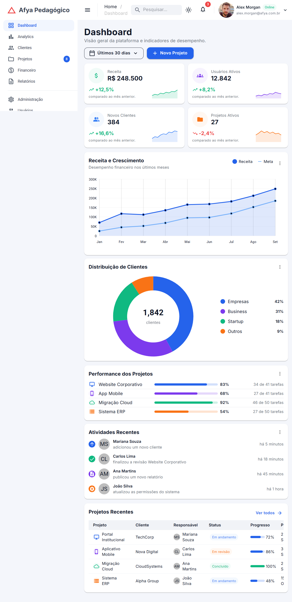
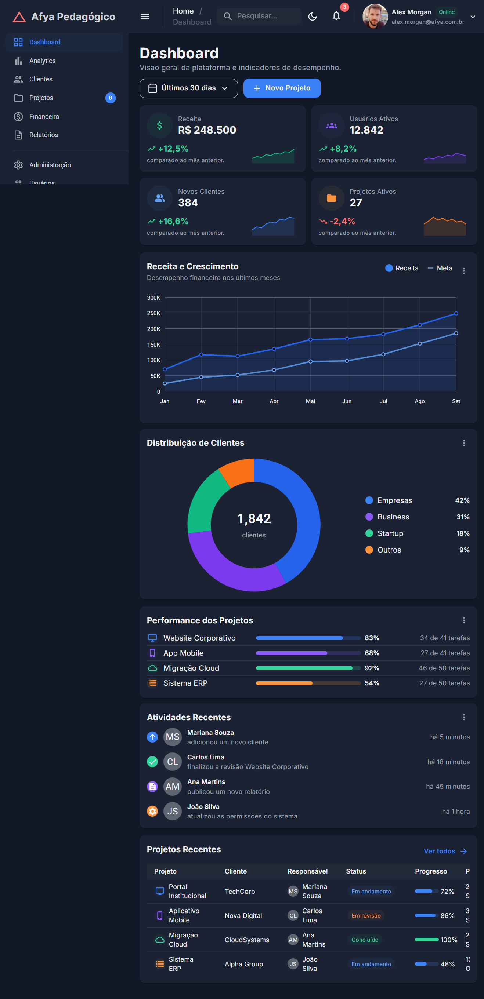
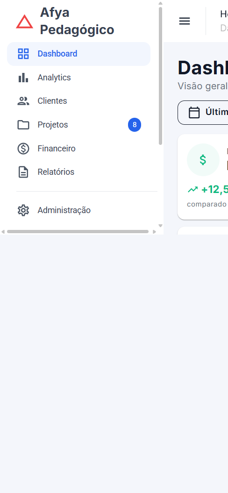
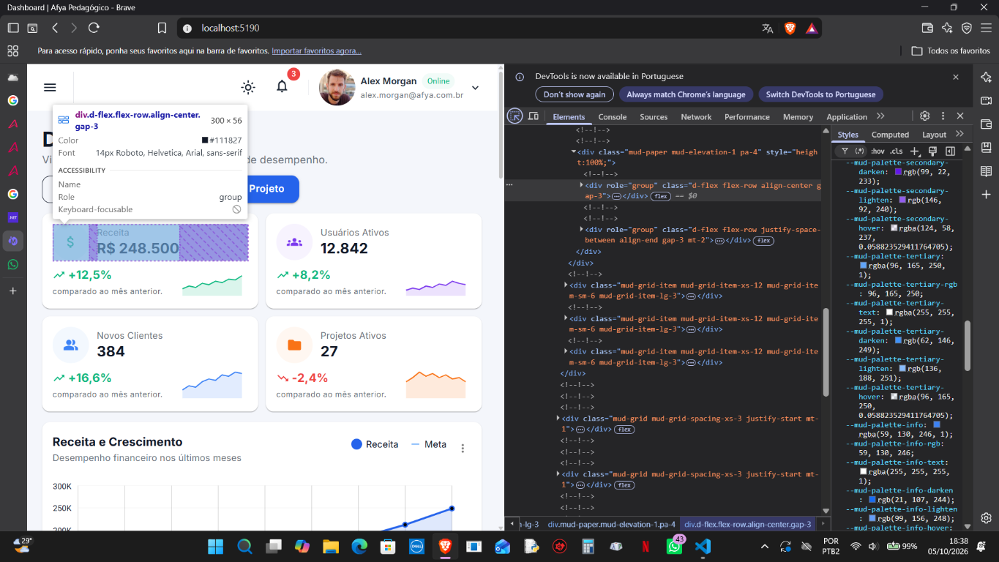

# Afya Admin — Dashboard com Blazor WebAssembly e MudBlazor

## Identificação

| | |
|---|---|
| **Aluno(a)** | Kauenny Leão Castro |
| **Matrícula** | Informar somente no Canvas; não publicar no repositório |
| **Faculdade** | Universidade São Lucas Porto Velho |
| **Curso** | Ciência da Computação |
| **Disciplina** | Programação para Sistemas Web |
| **Professor(a)** | Liluyoud Cury de Lacerda |
| **Semestre** | 2026.2 |

## Objetivo do projeto

Este projeto é um painel administrativo para a plataforma fictícia Afya Pedagógico. A página reúne indicadores e informações de projetos em um dashboard feito com Blazor WebAssembly e componentes MudBlazor.

Os dados apresentados são fictícios. O dashboard inclui indicadores, gráficos, performance dos projetos, atividades recentes e uma tabela de projetos. O layout também oferece tema claro e escuro e se adapta a telas menores.

## Tecnologias utilizadas

- .NET 10 / Blazor WebAssembly
- MudBlazor 9.11.0
- C# e Razor

## Como executar

1. Instale o .NET SDK 10.
2. Clone o repositório e entre na pasta do projeto:

```bash
git clone https://github.com/kauennyleao/afya-admin.git
cd afya-admin
dotnet watch
```

Abra no navegador o endereço local mostrado no terminal.

## Telas

### Tema claro


### Tema escuro


### Versão mobile


### HTML gerado (DevTools)


Na aba Elements, inspecionei um card de KPI. O Blazor e o MudBlazor geraram elementos `div` para estruturar o cartão; entre eles aparece um `div` com as classes `mud-paper mud-elevation-1 pa-4`, que corresponde ao `MudPaper` do componente. Também aparecem classes como `d-flex`, `flex-row`, `align-center` e `gap-3` nos elementos internos. Isso mostra como a classe utilitária `pa-4` escrita no Razor aparece no HTML gerado.

## Estrutura do projeto

```text
afya-admin/
├── Components/
│   ├── AtividadesRecentes.razor
│   ├── CabecalhoPagina.razor
│   ├── DashboardCard.razor
│   ├── GraficoDistribuicaoClientes.razor
│   ├── GraficoReceita.razor
│   ├── KpiCard.razor
│   ├── PerformanceProjetos.razor
│   ├── ProjetosRecentes.razor
│   ├── SeletorPeriodo.razor
│   └── Ui.cs
├── Data/
│   └── DashboardData.cs
├── Layout/
│   ├── MainLayout.razor
│   └── NavMenu.razor
├── Pages/
│   ├── Dashboard.razor
│   └── NotFound.razor
└── wwwroot/
    ├── css/
    ├── img/
    └── index.html
```

- `Components`: componentes reutilizáveis e elementos do dashboard.
- `Data`: modelos e dados fictícios usados para preencher a página.
- `Layout`: estrutura compartilhada, barra superior e menu lateral.
- `Pages`: páginas acessadas pelas rotas da aplicação.
- `wwwroot`: arquivos estáticos servidos pelo navegador.

## Componentes criados

| Componente | Responsabilidade | Parâmetros |
|---|---|---|
| `CabecalhoPagina` | Título, subtítulo e ações da página | `Titulo`, `Subtitulo`, `Acoes` |
| `SeletorPeriodo` | Seleção de período com binding Blazor | `Opcoes`, `Valor`, `ValorChanged` |
| `DashboardCard` | Base reutilizável para cartões | `Titulo`, `Subtitulo`, `Acoes`, `Menu`, `ChildContent` |
| `KpiCard` | Exibe um indicador e seu sparkline | `Kpi` |
| `GraficoReceita` | Gráfico de receita e meta mensais | `Meses`, `Receita`, `Meta` |
| `GraficoDistribuicaoClientes` | Gráfico de rosca e distribuição por segmento | `Total`, `Segmentos` |
| `PerformanceProjetos` | Progresso das tarefas de cada projeto | `Projetos` |
| `AtividadesRecentes` | Feed de atividades recentes | `Atividades` |
| `ProjetosRecentes` | Tabela responsiva de projetos | `Projetos` |

## O que aprendi

Estas são minhas respostas sobre o que entendi durante o projeto.

1. Como uma aplicação Blazor WebAssembly inicia no navegador? Qual é o papel do `index.html`, da `<div id="app">` e do `Program.cs`?

   O navegador abre o `index.html`, que tem a `<div id="app">` onde o Blazor mostra a aplicação. No `Program.cs`, o Blazor configura os serviços e indica que o componente `App` deve ser carregado nessa div. A partir daí, o `App` escolhe a página conforme a rota.

2. Qual é a diferença entre um Layout, uma Page e um Component neste projeto? Dê um exemplo de cada.

   O `MainLayout` é a moldura que aparece ao redor das páginas, com a barra de cima e o menu lateral. `Dashboard.razor` é uma Page, porque é a página principal que abre na rota `/`. Já `KpiCard` é um Component reutilizável que mostra um indicador; a página usa quatro deles.

3. O que é um `RenderFragment` e como o `DashboardCard` usa esse recurso para ser reutilizado por vários cards?

   `RenderFragment` permite que um componente receba conteúdo visual de quem está usando ele. No `DashboardCard`, por exemplo, posso passar um título e também conteúdo diferente dentro do cartão. Assim, o mesmo componente serve de base para os gráficos, a performance e as atividades.

4. Como funciona o `@bind-Valor` no `SeletorPeriodo`? Qual é o papel do `ValorChanged`?

   O `@bind-Valor` mantém o período selecionado sincronizado entre a página e o `SeletorPeriodo`. Quando escolho uma opção, o componente chama `ValorChanged` com o novo texto; assim a variável `_periodo` da página é atualizada.

5. Por que os dados ficam na pasta `Data`, separados dos componentes? Que vantagem isso traz se, no futuro, os dados vierem de uma API?

   Os dados fictícios ficam em `Data/DashboardData.cs`, separados dos componentes que cuidam da apresentação. Se os dados vierem de uma API no futuro, posso trocar de onde eles são carregados sem precisar reconstruir cada gráfico ou cartão.

6. Como o `MudGrid` com `xs`, `sm` e `lg` faz os cards de KPI se reorganizarem em telas de tamanhos diferentes?

   O grid divide a tela em 12 colunas. Cada card ocupa 12 colunas em `xs`, 6 em `sm` e 3 em `lg`. Por isso, no celular aparece um card por linha, em telas médias aparecem dois e em telas grandes aparecem quatro.

7. Como foi possível estilizar a página sem escrever CSS próprio? Explique o papel do tema (`MudTheme`) e das classes utilitárias.

   Usei as cores do `MudTheme` e os componentes do MudBlazor para controlar a aparência. As classes utilitárias, como `pa-4`, `d-flex` e `mud-text-secondary`, cuidam de espaçamento, alinhamento e cores de texto sem eu criar regras de CSS próprias.

8. Por que o namespace do projeto é `afya_admin` e não `afya-admin`?

   O nome da pasta e do projeto pode ter hífen, mas o hífen não pode fazer parte de um identificador C#. Por isso o .NET troca o hífen por sublinhado no namespace, que fica `afya_admin`.

## Dificuldades e soluções

Descreva pelo menos dois problemas que você enfrentou no desenvolvimento e como resolveu cada um.

1. No começo, eu esquecia de usar `cd` para entrar na pasta do projeto e tentava digitar o caminho como se fosse um comando. Com a orientação que recebi, passei a usar `cd "D:\projetos\afya-admin"` e depois executar `dotnet watch`.
2. Quando os cards não apareceram logo no site, pensei que tinha dado tudo errado com a página. A solução foi parar e iniciar o `dotnet watch` de novo; depois disso, os componentes apareceram.
3. No teste para celular, o menu lateral estava cobrindo parte da página. Ajustei, com a ajuda da IA, o comportamento para o menu iniciar fechado em telas pequenas e conferi novamente o dashboard nessa largura.

## Melhorias futuras

_Opcional: descreva o que implementaria a seguir ou algum desafio da seção 20 do tutorial._
